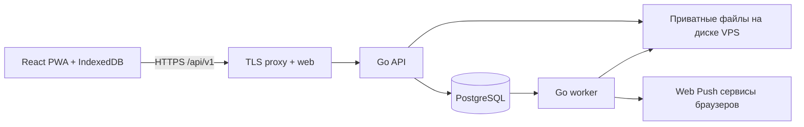

# Бэкенд «Подход»: модель данных и работа системы

Дата: 10 октября 2026. Задача: EGO-9. Статус: проект принят пользователем, реализация предстоит. Решение: [ADR-002](adr/002-backend.md). Контракт: [API](api.md). Эксплуатация: [деплой](deployment.md).

## Границы и продуктовые правила

Несколько независимых аккаунтов, регистрация с почтой/логином/паролем, приватные данные без общего каталога пользователей. Отправки писем пока нет, email неподтверждённый. Несколько способов входа в один аккаунт описаны в [ADR-003](adr/003-authentication.md); он заменяет прежнюю схему email-кодов. MVP использует повторяющийся недельный шаблон на заданный период; разные недели можно добавить позднее новой версией контракта. Даты периода включительны, дни недели ISO 1–7. Количество тренировочных дней вычисляется из выбранных дней, отдельно не хранится. Один действующий план и максимум одна плановая тренировка на дату; допускаются дополнительные фактические тренировки.

Вес в кг — десятичное число, без float. План и факт имеют отдельные поля. Отсутствие фактического значения не означает ноль. Нулевой вес допустим для упражнений без внешнего отягощения; повторения выполненного подхода положительны. В MVP модель упражнений — вес и повторения, без произвольных формул для времени/дистанции. Варианты упражнения — разные записи библиотеки, прогресс между ними автоматически не объединяется.

Будущие даты вычисляются из программы; строки на каждый день многолетнего календаря заранее не создаются. Исключения расписания и начатые тренировки хранятся явно. Пропуск определяется после окончания локальной даты, если нет начала/завершения или отмены. «Пропущено» не требует ночного массового UPDATE.

Даты календаря — `date`, время событий — `timestamptz` UTC, timezone — имя IANA. Программа и тренировка сохраняют свой timezone; смена настройки пользователя не переносит прошлую историю. Дата тренировки фиксируется при начале, переход через полночь не дробит её. Перенос меняет плановую дату явно.

## Компоненты

API отвечает за авторизацию, проверки и транзакции. Worker отправляет push, обрабатывает фото, выполняет экспорт и очистку. По [ADR-004](adr/004-small-vps.md) файлы первой версии приватно хранятся на VPS и выдаются через API; внешние зашифрованные копии обязательны. Ранее описанный S3 поток ниже сохраняет требования к staging/final и является вариантом последующего переноса; первая реализация upload/read URL использует same-origin API с проверкой владельца. Один Go-образ, разные точки запуска `cmd/api`, `cmd/worker`, `cmd/migrate`; пакеты добавляются при реализации: `auth`, `exercises`, `programs`, `workouts`, `journal`, `media`, `reminders`, `sync`, `jobs`. HTTP обработчик → доменный сервис → SQL repository. Используем `net/http`, `pgx`, явные SQL-запросы; sqlc можно подключить для генерации типов после фиксации SQL. Миграции нумерованные и неизменяемые. Не вводим универсальный CRUD для всех таблиц.

## Схема PostgreSQL

Это логическая спецификация таблиц для будущих миграций. `id` — UUID, включая генерируемые клиентом ID; авторизация никогда не доверяет самому ID. Во всех приватных таблицах `user_id NOT NULL`, FK к `users`. `created_at`, `updated_at` назначает сервер. У изменяемых корней `version bigint >= 1`; удаление синхронизируемых записей сначала оставляет tombstone. Дочерние записи принадлежат версии корня и отдельно не конкурируют. `?` ниже означает nullable. Идентификаторы и ограничения явно закрепляются SQL-миграциями при реализации.

### Доступ

| Таблица                | Колонки сверх общих                                                                                                     | Ограничения / назначение                                                    |
| ---------------------- | ----------------------------------------------------------------------------------------------------------------------- | --------------------------------------------------------------------------- |
| `users`                | `login_normalized`, `email_normalized?`, `email_verified_at?`, `timezone`, `locale`, `status`, `deletion_requested_at?` | UNIQUE login; UNIQUE только подтверждённой почты; active/deleting           |
| `password_credentials` | `user_id` PK, `password_hash`, `changed_at`                                                                             | Argon2id с солью, максимум один пароль; подтверждение пароля не хранится    |
| `auth_identities`      | `user_id`, `provider`, `subject`, `last_used_at`                                                                        | Будущие внешние входы; UNIQUE(provider, subject), UNIQUE(user_id, provider) |
| `auth_flows`           | provider/purpose, browser binding/state/nonce hashes, encrypted verifier, subject?, TTL/consumed_at                     | Будущие login/link/reauth/delete_account, одноразовое завершение            |
| `auth_rate_limits`     | HMAC ключ области/логина/IP, окно, счётчик, expires_at                                                                  | Межпроцессные лимиты и очистка                                              |
| `sessions`             | `token_hash bytea`, `device_id uuid`, `expires_at`, `last_seen_at`, `revoked_at?`                                       | UNIQUE token_hash; токен криптографически случайный, в БД только хеш        |
| `devices`              | `label text`, `last_seen_at`, `revoked_at?`, `version`                                                                  | ID для синхронизации и подписок, не credential                              |

### Библиотека и план

| Таблица                 | Колонки сверх общих                                                                                         | Ограничения / назначение                                                                                             |
| ----------------------- | ----------------------------------------------------------------------------------------------------------- | -------------------------------------------------------------------------------------------------------------------- |
| `exercises`             | `name text`, `normalized_name text`, `note text`, `archived_at?`, `version`                                 | Индекс (user_id, normalized_name); имена могут совпадать, UI предупреждает; архивирование не ломает историю          |
| `technique_guides`      | `exercise_id`, `body text`, `source_title`, `source_url`, `reviewed_at`, `source_accessed_at`               | Проверенный редактором материал; обычный пользователь не помечает собственный текст проверенным; может отсутствовать |
| `programs`              | `name text`, `current_revision_id uuid`, `archived_at?`, `archived_from date?`, `version`                   | Корень программы; ревизии неизменяемы после публикации; archived_from ограничивает будущий план                      |
| `program_revisions`     | `program_id`, `revision_no int`, `effective_from date`, `start_date date`, `end_date date`, `timezone text` | UNIQUE (program_id, revision_no); start <= effective_from <= end; публикация атомарна                                |
| `program_days`          | `revision_id`, `weekday smallint`                                                                           | UNIQUE (revision_id, weekday); CHECK 1..7; минимум один день на публикации                                           |
| `program_day_exercises` | `day_id`, `exercise_id`, `position int`, `name_snapshot text`, `note text`                                  | UNIQUE (day_id, position); повтор упражнения разрешён                                                                |
| `program_set_targets`   | `day_exercise_id`, `position int`, `weight_kg numeric(7,2)?`, `reps_min int`, `reps_max int`                | UNIQUE (day_exercise_id, position); >= 1 подход, weight >= 0, 1 <= min <= max <= 1000                                |
| `schedule_exceptions`   | `program_id`, `source_date date`, `target_date date?`, `action text`, `version`                             | UNIQUE (program_id, source_date); action cancel/move; target только для move                                         |

Количество подходов равно числу строк targets. Одинаковые цели можно развернуть из `setCount` формы. Так позднее можно задавать разные веса/повторения отдельных подходов без смены модели.

Редактирование публикует новую ревизию с `effective_from`, не меняет прежние. Под блокировкой пользователя проверяем отсутствие пересекающихся действующих периодов разных программ; интервалы одной программы покрываются ревизией с максимальным effective_from <= дате. В MVP нельзя задним числом менять расписание: effective_from >= текущей даты в timezone программы. Снимки начатых тренировок остаются прежними, включая начатые сегодня. Перенос не выходит за период программы и не занимает уже занятую плановую дату; цепочки переносов и обратный перенос задаются заменой одной записи исключения. Изменение версии программы повторно проверяет переносы, несовместимые изменения возвращают конфликт.

### Фактическая тренировка

| Таблица             | Колонки сверх общих                                                                                                                                                              | Ограничения / назначение                                                                                                                                                       |
| ------------------- | -------------------------------------------------------------------------------------------------------------------------------------------------------------------------------- | ------------------------------------------------------------------------------------------------------------------------------------------------------------------------------ |
| `workouts`          | `program_id?`, `program_revision_id?`, `scheduled_date?`, `local_date date`, `timezone`, `status`, `started_at`, `finished_at?`, `current_revision_id`, `version`                | active/completed/discarded; частичный UNIQUE user_id WHERE active; частичный UNIQUE (user_id, program_id, scheduled_date) для status != discarded и scheduled_date IS NOT NULL |
| `workout_revisions` | `workout_id`, `revision_no`, `reason text?`, `created_at`                                                                                                                        | UNIQUE (workout_id, revision_no); первая ревизия редактируется только пока active; завершённые ревизии неизменяемы                                                             |
| `workout_exercises` | `workout_revision_id`, `exercise_id`, `position`, `name_snapshot`, `note`, `technique_snapshot jsonb?`                                                                           | Снимок имени и источника; UNIQUE (revision_id, position)                                                                                                                       |
| `workout_sets`      | `workout_exercise_id`, `position`, `planned_weight_kg?`, `planned_reps_min?`, `planned_reps_max?`, `status`, `actual_weight_kg?`, `actual_reps?`, `started_at?`, `completed_at?` | pending/completed/skipped; UNIQUE (exercise_id, position); completed требует actual_weight >= 0, actual_reps 1..1000 и completed_at                                            |
| `rest_intervals`    | `workout_revision_id`, `after_set_id`, `started_at`, `ended_at?`, `end_reason?`                                                                                                  | UNIQUE after_set_id; один незакрытый на ревизию; ended >= started; reason next_set/finish/correction                                                                           |
| `workout_events`    | `workout_id`, `command_id`, `type`, `occurred_at`, `received_at`, `payload jsonb`                                                                                                | Аудит принятых действий, не полное event sourcing; команда уникальна в command_receipts                                                                                        |

FK между приватными сущностями составные `(user_id, parent_id)` → `(user_id, id)`, у родителей соответствующий UNIQUE. Для фото, rest и подходов дополнительно проверяется принадлежность одной ревизии. В SQL constraints — скалярные CHECK/UNIQUE/FK; проверки нескольких строк (минимум один день, интервалы, полная ревизия) выполняются сервисом в одной транзакции. При реализации нужен запрет изменения завершённых ревизий также на уровне БД (триггер и ограниченные роли); физическая очистка аккаунта — отдельная роль.

### Дневник, фотографии и фоновые операции

| Таблица                   | Колонки сверх общих                                                                                                                                          | Ограничения / назначение                                                                               |
| ------------------------- | ------------------------------------------------------------------------------------------------------------------------------------------------------------ | ------------------------------------------------------------------------------------------------------ |
| `day_notes`               | `local_date`, `body text`, `version`                                                                                                                         | UNIQUE (user_id, local_date); заметка дня независима от тренировки                                     |
| `photos`                  | `local_date`, `workout_id?`, `status`, `upload_key`, `image_key?`, `thumbnail_key?`, `expected_size`, `checksum`, `width?`, `height?`, `position`, `version` | pending/processing/ready/failed/deleting; UNIQUE upload_key; день обязателен даже без тренировки       |
| `reminder_rules`          | `enabled bool`, `local_time time`, `timezone`, `version`                                                                                                     | UNIQUE user_id; одно напоминание на тренировочную дату в MVP                                           |
| `push_subscriptions`      | `device_id`, `endpoint_encrypted`, `endpoint_hash`, `p256dh`, `auth_encrypted`, `expires_at?`, `disabled_at?`, `version`                                     | UNIQUE endpoint_hash; endpoint и auth не логировать                                                    |
| `notification_deliveries` | `subscription_id`, `program_id`, `scheduled_date`, `scheduled_at`, `expires_at`, `rule_version`, `state`, `attempts`, `last_error_code?`                     | UNIQUE (subscription_id, program_id, scheduled_date); queued/sending/accepted/expired/failed/cancelled |
| `jobs`                    | `kind`, `payload jsonb`, `dedupe_key`, `available_at`, `attempts`, `lease_until?`, `lease_token?`, `state`, `last_error_code?`                               | Не всякая задача имеет user_id (системная очистка); UNIQUE dedupe_key; ready/running/done/dead         |
| `command_receipts`        | `device_id`, `command_id`, `payload_hash`, `result jsonb`, `created_at`                                                                                      | UNIQUE (user_id, command_id); ответ на повтор сохраняется 90 дней                                      |
| `sync_heads`              | `seq bigint`                                                                                                                                                 | PK user_id; блокируем строку при каждой приватной записи, seq повышается в транзакции                  |
| `change_log`              | `seq bigint`, `entity_type`, `entity_id`, `operation`, `entity_version`                                                                                      | PK (user_id, seq); операция upsert/delete; версии и tombstones, хранение 90 дней                       |
| `data_exports`            | `status`, `object_key?`, `expires_at?`                                                                                                                       | queued/ready/failed; временный приватный архив JSON и обработанных фото                                |

Индексы: workouts (user_id, local_date DESC), photos (user_id, local_date, status), program_revisions (user_id, program_id, effective_from DESC), workout_exercises (user_id, exercise_id, workout_revision_id), change_log (user_id, seq), jobs (available_at) WHERE ready и (lease_until) WHERE running, deliveries (scheduled_at) WHERE queued. FK-колонки индексировать по реальным запросам. Прогресс сначала SQL по текущим завершённым ревизиям; отдельные агрегаты только после измерений.

## Вход и изоляция

1. Регистрация принимает email, login, password и passwordConfirmation; сервер проверяет совпадение, нормализует login/email и сохраняет Argon2id-хеш отдельно от профиля. User/credential/sync_head/device/session создаются атомарно. Письма не отправляются; email_verified_at=NULL. Правила уникальности, длины и лимитов — [ADR-003](adr/003-authentication.md).
2. Вход проверяет login/password; неизвестный логин и неправильный пароль имеют одинаковый ответ. Лимиты регистрации и входа хранятся в PostgreSQL. Смена пароля требует текущего пароля и отзывает остальные сессии; неподтверждённый email не подходит для восстановления или автоматической привязки.
3. Пароль или подтверждённая identity провайдера разрешается в один users.id. Cookie `__Host-podhod_session`: HttpOnly, Secure, SameSite=Lax, Path=/, без Domain. Время жизни 30 дней, ротация при повторном входе, отзыв при выходе и удалении аккаунта. Telegram/Яндекс/VK — будущие адаптеры с одноразовыми flows и безопасной привязкой к существующему аккаунту.
4. Для мутаций проверяем Origin и CSRF-токен, полученный через GET auth/session; JSON Content-Type обязателен. CORS выключен для сторонних origin. Backend получает user_id только из сессии, во всех SQL запросах фильтрует владельца. Чужой ID возвращает 404.

Cookie-флаги и серверный жизненный цикл сессии согласуются с [OWASP Session Management](https://cheatsheetseries.owasp.org/cheatsheets/Session_Management_Cheat_Sheet.html). Перед выпуском проверяем перебор пароля, регистрацию, CSRF, чужие parent ID и утечки фото. Ограничения PostgreSQL должны работать при двух экземплярах API. Подключение провайдеров не меняет ownership; почтовый провайдер первой версии не требуется.

## Тренировка и отдых

Начало копирует выбранный снимок плана в workout revision. Клиент для офлайна хранит опубликованную ревизию и её ID: команда start может ссылаться на старую ревизию, если она была доступна пользователю и соответствовала дате до последующего изменения. Сервер проверяет факт владения, дату и отсутствие другого запуска, не заменяет старый план молча. Независимая тренировка без программы создаётся с явным набором упражнений из личной библиотеки.

`complete_set` сохраняет явные фактические значения и одновременно открывает отдых по timestamp завершения. `begin_set` закрывает текущий отдых и записывает started_at следующего pending подхода. Завершение тренировки закрывает оставшийся отдых с reason finish. В сводке общий отдых включает финальный интервал; средний отдых между подходами включает только reason next_set. При незавершённых подходах клиент явно подтверждает перевод оставшихся в skipped.

Отмена последней отметки допустима пока не начат следующий подход: возвращает pending и удаляет связанный отдых из активной ревизии, аудит остаётся. После последующих действий исправление факта идёт отдельной командой correction без молчаливой перестройки временной шкалы. Активную тренировку можно discard с сохранением аудита; она исключается из графиков и освобождает плановую дату для нового запуска.

Восстановление таймера: запись состояния и команды в одной IndexedDB транзакции до подтверждения интерфейсом. Отображаемое время = now - started_at, interval только обновляет экран. На активной вкладке можно сверять monotonic clock и wall clock; после перезапуска доступен сохранённый wall timestamp. Сервер сохраняет occurred_at и received_at раздельно. При обратном времени или подозрительном скачке показываем необходимость уточнить интервал, не рисуем отрицательное время; клиентский timestamp не является доверенным временем для auth/TTL. Фоновые таймеры и push не используются как гарантия точности отдыха.

Исправление завершённой тренировки клонирует текущую ревизию, применяет полный проверенный набор исправлений, фиксирует reason и атомарно переключает current_revision_id/version. Предыдущая остаётся доступной для аудита. Изменение программы никогда не запускает эту операцию. Фото и заметка дня редактируются независимо от результатов.

## Офлайн и синхронизация

Поддерживаем офлайн тренировочный цикл, дневник и подготовку фотографий. Публикация программы, вход и изменение напоминаний требуют сети в MVP. Библиотечные упражнения можно создать локально и синхронизировать перед зависимым start. Без предварительно сохранённого плана нельзя обещать офлайн доступ ко всей истории.

Команда содержит `commandId`, `deviceId`, `aggregateId`, `expectedVersion`, `type`, `occurredAt`, `payload`. Клиент отправляет команды одного агрегата последовательно. Сервер блокирует sync_heads пользователя, проверяет receipt, затем агрегат и expectedVersion; данные, повышенная version, seq, change_log, receipt и job записываются одной транзакцией. Все другие мутации пользователя используют тот же порядок блокировок. Это сериализует короткие приватные записи пользователя, но не всех пользователей.

Повтор commandId с тем же payload возвращает исходный результат до проверки текущей версии, иной payload — 409. Для зависимых команд версии прогнозируются по одному увеличению на принятую команду; отклонение останавливает очередь агрегата. Batch принимает до 50 команд и 1 MiB, каждая имеет свою транзакцию и результат; частичный успех явный. Не атомарный batch. Обычные REST-мутации используют тот же receipt и механизм версий, а не вторую реализацию правил.

409 возвращает текущую версию и данные, локальные данные сохраняются. При start конфликте с другой тренировкой пользователь выбирает продолжение существующей либо сохранение локальной как отдельной после завершения/отмены активной. Без версии запрещено перезаписывать результат. Для заметки предлагается ручное слияние текста. При двух офлайн устройствах нельзя гарантировать отсутствие конфликтов; гарантируем их обнаружение.

`GET sync/changes` выдаёт упорядоченные изменения до фиксированного highWatermark, вместе с актуальными представлениями агрегатов и tombstones. Представление может быть новее seq записи: клиент принимает только более высокую version и продолжает читать до watermark; следующая страница/цикл доставит остальные изменения. Seq выделяется под sync_heads lock и поэтому не пропускает поздно закоммиченные транзакции (обычная sequence сама этого не гарантирует). Первый bootstrap: repeatable-read снимок, watermark и постраничный архив локальных данных через временный snapshot ID; живую пагинацию разных снимков не смешиваем.

Cursor подписан, привязан к user_id; просроченный (>90 дней) даёт 410 resync_required. Полный bootstrap заменяет серверный cache, но сохраняет unsent commands и локальные фото; pending результаты повторно сверяются. После 90 дней команда не воспроизводится автоматически: пользователь сверяет результат и повторяет действие новым ID при необходимости. Ввод offline хранится до подтверждения сервера. На 401 очередь замораживается до входа в тот же аккаунт; другой аккаунт не получает чужую IndexedDB. Выход предупреждает о несинхронизированных записях и очищает приватный cache после выбранного пользователем действия. Service worker кеширует app shell, приватные API не кладёт в общий Cache Storage.

## Фотографии

До загрузки файл хранится локально, назначаются photo ID, день и checksum. API резервирует запись и уникальный staging key, выдаёт краткую upload ссылку. Ссылка не является разрешением на произвольный bucket/key. Предлагаемые пределы: 10 MiB/фото, 20 фото/день, 1 GiB/аккаунт; учёт pending резервов блокирует обход параллельными загрузками.

После PUT клиент вызывает complete. Worker проверяет реальный размер, checksum, формат декодером и предел 30 мегапикселей; поддержка JPEG/PNG/WebP, HEIC требует отдельного проверенного конвертера, иначе явная ошибка. Затем ориентирует изображение, удаляет EXIF/GPS, создаёт отображаемую копию и thumbnail, записывает **новые** финальные ключи. Исходник из staging удаляется. Ready публикуется только после подтверждения финальных объектов. Так повтор PUT по ещё действующей ссылке не меняет уже проверенную фотографию. [S3 presigned URL](https://docs.aws.amazon.com/AmazonS3/latest/userguide/using-presigned-url.html) может использоваться повторно до истечения и перезаписывает совпавший ключ, поэтому staging отделён от финальных файлов.

GET ссылок — только после проверки владельца, TTL 5 минут, Cache-Control private; в календаре максимум две thumbnail и общее количество. Bucket закрыт, публичных ACL нет, CORS для upload только origin приложения. Ни URL, ни key не являются постоянной частью публичного контракта. Очистка незавершённых staging через 24 часа, удаление ready через job с повтором. Потерянный callback после обработки восстанавливается повторным complete/status. Фото недоступно, пока processing; тренировка от него не зависит. Скачанная копия может остаться в личном кеше устройства после удаления, поэтому UI не обещает отзыв уже скачанных файлов.

## Напоминания и задачи

Напоминания — о тренировочном дне, а не об отдыхе. В MVP выбранное локальное время и timezone пользователя (при создании берём текущий, потом меняем явно). Worker рассчитывает ближайшие 7 дней, периодически и при изменении расписания/rule обновляет delivery. При DST пропавшее время переносится на первый допустимый момент, повторённое отправляется один раз в первое вхождение. Перед отправкой заново проверяет enabled, версию правила, отмену/перенос и начатую тренировку. Старые доставки отменяются, новые создаются для актуальных дат.

Разрешение push запрашивается клиентом по действию пользователя в настройках после объяснения. На iOS необходима установка на Home Screen; [WebKit](https://webkit.org/blog/13878/web-push-for-web-apps-on-ios-and-ipados/) описывает поддержку начиная с iOS/iPadOS 16.4. До выпуска проверяем актуальные целевые устройства. Сервер хранит подписку каждого устройства и отправляет шифрованный Web Push с VAPID. Payload без упражнений и личных данных, только общая фраза и внутренний маршрут. VAPID private key — постоянный секрет с резервной копией; смена требует обновления подписок.

Push endpoint — недоверенный URL: HTTPS, allowlist проверенных push-сервисов целевых браузеров, запрет private/link-local IP и redirects, безопасная DNS проверка при соединении, исходящие сетевые ограничения. Нельзя реализовать произвольный POST к переданному URL. Правила SSRF проверяются по [OWASP](https://cheatsheetseries.owasp.org/cheatsheets/Server_Side_Request_Forgery_Prevention_Cheat_Sheet.html).

Worker забирает задачи небольшими пачками через `FOR UPDATE SKIP LOCKED`, назначает lease 60 секунд и уникальный lease_token, коммитит перед сетевой операцией. Продление lease и завершение принимаются только с текущим token. Просроченный lease возвращает задачу в ready; backoff с jitter, максимум 8 попыток, затем dead и сигнал оператору. Операции с объектами идемпотентны. Push после внешнего успеха и падения worker может отправиться повторно: доставка at-least-once, не обещаем exactly-once. Для push tag совпадает с delivery ID. Ответ push 2xx означает принятие сервисом, не показ на устройстве; 404/410 отключает подписку, 429/5xx повторяются до TTL 2 часа. После TTL не рассылаем устаревшее напоминание.

## Календарь, прогресс, экспорт и удаление

Календарь объединяет вычисленный план, исключения, фактические тренировки, заметки и ready фото по локальной дате. День может содержать несколько результатов, отдельный план и фотографии без тренировки. Плановая дата и фактическая дата различаются и явно возвращаются. Перенос сохраняет исходную дату и маркер переноса, без двойного напоминания.

Прогресс читает только current revision completed тренировок: максимальный actual_weight, число completed подходов, сумма actual_reps, сумма weight × reps. Skipped, active, discarded и прежние ревизии исключены. Сводка сравнивает первый и последний факт периода; при нулевом исходном весе процент не вычисляется. При недостатке данных — записи без выдуманного роста. Индекс/план запроса проверяется на реальной истории перед выделением агрегатов.

Экспорт выполняется job, архив доступен приватной ссылкой 24 часа. Удаление аккаунта требует свежей реаутентификации паролем или подключённым провайдером с purpose=delete_account, атомарно отзывает сессии/подписки, блокирует записи и запускает физическую очистку БД и объектов. Повторы job безопасны; завершение подтверждается только после удаления. Бэкапы живут до срока retention, не обещаем немедленное удаление из них. Отдельный реестр подтверждённых удалений вне основного снимка применяется до открытия восстановленной БД, чтобы не вернуть удалённые аккаунты.

## Проверка и порядок реализации

1. EGO-9: согласовать эту модель, API, безопасность, бюджет и ADR. Затем конкретизировать OpenAPI и SQL миграции в этапе основы, без реализации всего backlog здесь.
2. EGO-8: ранняя реальная установка/push на целевых устройствах с минимальной инфраструктурой.
3. Основа: PostgreSQL, миграции, парольные сессии, ownership, health/readiness, backup/restore.
4. Программа и тренировка: ревизии, снимок, подходы, timestamp отдыха, локальные команды и конфликты.
5. Дневник/фото/прогресс: обработка, агрегации, приватность, экспорт/удаление.
6. Надёжность: reminders, очистка, контракт старого клиента, отказ сервера, приёмка на устройствах.

Обязательные будущие проверки: два параллельных старта; повтор команды после потерянного ответа; start по старой ревизии офлайн; правка программы при активной/завершённой тренировке; два устройства меняют факт; undo/последний отдых; смена timezone/DST/полночь; seq при конкурентных commit; expired cursor; чужие ID; повтор PUT после ready; поддельный MIME; SSRF; worker падает после внешней отправки; восстановление VPS из внешнего backup. Это критерии реализации, не результаты уже выполненных тестов.
